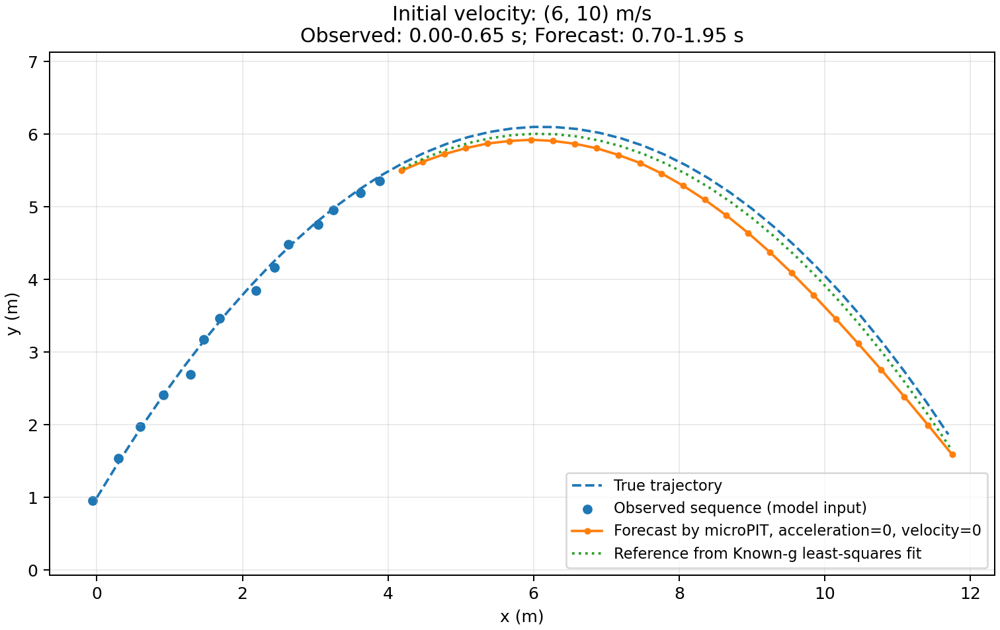
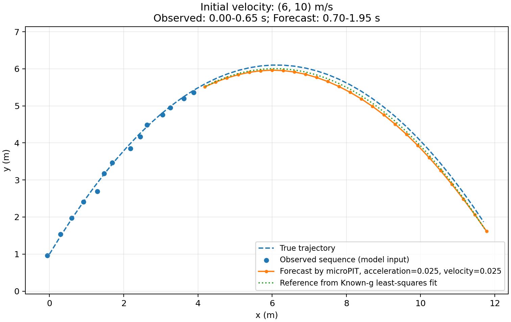

# microPIT: micro Physics-Informed Transformer

Based on [microgpt by Andrej Karpathy](https://gist.github.com/karpathy/8627fe009c40f57531cb18360106ce95).

A minimal implementation of a physics-informed transformer for projectile motion prediction.

## Scripts

- [microgpt.py](microgpt.py): Original microgpt implementation by @karpathy.
- [microgpt_jax.py](microgpt_jax.py): JAX rewrite of `microgpt.py`.
- [micropit.py](micropit.py): An example implementation of a physics-informed transformer for projectile motion prediction.

## Disclaimer

- This is a toy example for my learning purposes only.
- The physics model here is a minimal implementation of the projectile motion with no air resistance nor ground collision. 

## Usage

```bash
# Optional: Create a virtual environment
python -m venv venv
source venv/bin/activate  # Linux/macOS

# Install dependencies: jax, numpy, and matplotlib
pip install -r requirements.txt

# Run the original microgpt implementation
python microgpt.py

# Run the JAX rewrite of microgpt
python microgpt_jax.py

# Run the physics-informed transformer example
python micropit.py
```

## Example Output

Modify `physics_weight` in `micropit.py` to see the effect of physics-informed loss on the predicted trajectory.

> NOTE: Value below may not be the optimal setting.

| Physics OFF<br>(physics_weight = 0.00) | Physics ON<br>(physics_weight = 0.025) |
|-------------|------------|
|  |  |

## License

Licensed under the [MIT License](LICENSE).
